# promo-finder

**Finds the promo clips hiding in a micro-drama's scripts, and proves they work.**

Give it a folder of timestamped screenplays. It hands an editor a ranked slate of 20–60 s promos: exact in and out points for every segment, the hook, the cliffhanger, why it works, which part of the show to take each one from, and the question each one leaves a stranger with, plus the episode where the show answers it. It then checks its own picks against nine editor's rules, a blind first-time viewer, the writers' own cliffhangers, and promos cut by professional editors on shows it has never seen.

> Kuku AI Generalist Assignment, Problem 1 ("Find the Promos"). Siddhant Jain · 23113142.
> Prototype: *(Streamlit link in the submission form)* · Colab: [`notebooks/promo_finder_colab.ipynb`](notebooks/promo_finder_colab.ipynb) · Solution doc: in the submission form

## How it works

```mermaid
flowchart LR
    S[("Scripts<br/>timestamped lines")] --> R["1 · Read<br/>lines, actions, camera cuts<br/>+ QA report"]
    R --> A["2 · Score every line<br/>would it hook? leave you hanging?<br/>+ the whole show's arc"]
    A --> C["3 · Cut clips<br/>20–60 s, start on a cut,<br/>hook inside 3 s"]
    C --> K["4 · Check it<br/>9 editor's rules +<br/>a viewer who never saw the show"]
    K --> L["5 · Build the slate<br/>55% opening · 33% middle · 12% late<br/>(the shape of professional ads)"]
    L --> P["6 · Promise & payoff<br/>the question it plants →<br/>the episode that answers it"]
    P --> E(["Editor<br/>approve · trim · CSV · ffmpeg"])
    classDef ai fill:#f3e8ff,stroke:#7e22ce,color:#3b0764
    classDef code fill:#e0e7ff,stroke:#3b5bdb,color:#1e3a8a
    classDef human fill:#dcfce7,stroke:#2f9e44,color:#14532d
    class A,K,P ai
    class R,C,L code
    class E human
```



Purple steps are the AI and blue steps are code. **The AI never writes a timestamp.** It scores lines by id; every cut, rule and ranking is deterministic code, and the weights live in [`config.yaml`](config.yaml). With no API key, a keyword-based twin runs the same pipeline instantly.

## How the ranking works (all of it is plain arithmetic in code)

The AI's only job is to score each line, by its id. Every number below lives in [`config.yaml`](config.yaml), and every intermediate value is written to `promos.json`, so any rank can be recomputed by hand.

1. **Candidates** ([`candidates.py`](promo_finder/candidates.py)). Every pairing of a strong opening line with a later strong closing line becomes a clip.
   - The clip starts on the camera cut before the opening line, which must land within 3 s, and ends after the closing line.
   - It must run 20–60 s, and no line may be cut in half.
   - The end of one episode can join the start of the next.
2. **Sub-scores, each 0–1** ([`rank.py`](promo_finder/rank.py) `score_window`):
   - *hook* is the AI's 0–3 score of the opening line, divided by 3. It gets +0.5 on the 0–3 scale if a physical action lands in the first 3 s.
   - *cliff* is the AI's 0–3 score of the closing line, divided by 3. It gets +0.5 if the writers' own end-of-episode cue falls within 2 s. A declaration of love is capped at 2/3.
   - *stands alone* is the share of lines without unexplained names or events. For the shortlist it is replaced by the first-time viewer's 1–5 rating, divided by 5.
   - *pace* is the share of the clip filled with dialogue, halved if below 35%, times a length factor: 1.0 for 25–45 s, falling to 0.6 at 20 s or 60 s.
3. **Score** ([`rank.py`](promo_finder/rank.py) `combine`). The base is `0.35·hook + 0.30·cliff + 0.25·stands alone + 0.10·pace`. That base is then multiplied by:
   - a penalty for each failed editor's check ([`rubric.py`](promo_finder/rubric.py)): ×0.75 for spending the payoff, down to ×0.92 for the mildest;
   - ×1.05 if the clip comes from a turning-point episode (not the climax);
   - ×0.9 for a two-part join.
4. **De-duplication** (`nms`). A clip is dropped if it overlaps a better one by half its time, or shares its opening or closing line.
5. **The slate** ([`slate.py`](promo_finder/slate.py)). The show is split into its opening (first 20% of episodes), middle (20–50%) and late part, which get 55% / 33% / 12% of the places, the shape of professional ads. Within each part, picks go best-first with variety (`diversity_order`):
   - at most 2 per episode in the top 10;
   - ×0.85 for each clip already taken from the same episode;
   - ×0.90 if the clip opens on the same kind of beat as the previous pick.
6. **Shortlist → judge → final** ([`judge.py`](promo_finder/judge.py), `apply_judge`).
   - The 40-clip shortlist goes to the blind first-time viewer. Its rating replaces *stands alone*, and its checks (stakes clear, someone to root for, question still open) are applied.
   - Everything is re-scored, and the final 20 are picked with the same quotas.
   - The posting order runs opening first, best first within each part.

**Worked example (the official #1).**
- Base: hook 1.00, cliff 0.667, stands alone 0.80, pace 0.92, giving 0.35·1.00 + 0.30·0.667 + 0.25·0.80 + 0.10·0.92 = **0.842**.
- No check failed (×1.00), and it comes from a turning-point episode (×1.05), so the score is **0.884**.
- It is the best clip in the opening part, so it is posted first. #2 scores 0.883 with no turning-point lift.

**Honest caveat:** the weights and penalties are hand-set priors from the research, not learned from data. The editor's approve/reject log is there to refit them on real hook rate and hold rate.

## What makes a promo work (and how each rule is checked)

"Good" sounds subjective, but the people who cut promos at scale agree on five things. Sources are in [`docs/research.md`](docs/research.md).

| A promo that works… | Evidence | Check in the tool |
|---|---|---|
| grabs attention in 3 seconds | Meta: up to 47% of an ad's value lands in the first 3 s; Chinese micro-drama editors' "golden three seconds" | the hook starts ≤ 3 s after the cut, on conflict rather than setup |
| makes sense to a stranger | curiosity needs a visible gap (Loewenstein); HIVE/DramaAD (EMNLP 2025) | ≤ 3 speakers; no unexplained names; the judge can state "X wants Y, but Z" |
| gives you someone to root for | suspense needs a liked character in danger (Zillmann) | the judge names whom they side with |
| stops before the payoff | micro-drama's compress-and-release writing; the best ads cut just before the strike-back | no release after the last escalation; the judge says the question is still open |
| keeps its promise | fake-hook ads drew backlash and takedowns | verbatim clips only; the promise ledger finds where the show answers the question |

Each failed check costs a fixed share of the clip's score and shows as a red pill on its card. Nothing is hidden from the editor.

## Where promos come from: measured, not guessed

DramaAD covers [501 ads cut by professional editors from 28 short dramas](https://huggingface.co/datasets/wonderful9462/DramaAD). In it, **55% of ad footage comes from the first 20% of episodes**, 33% from 20–50% and 13% from the second half, and 55% of ads open in the first 20%. The slate copies that shape and posts the opening first (`scripts/benchmark_dramaad.py stats` reproduces the numbers). `--paywall N` makes the opening exactly the free episodes.

## Results (official run on the 50-episode pack, free open model)

| | |
|---|---|
| Rules followed (20–60 s, hook ≤ 3 s, starts on a cut) | 100% of clips |
| Slate shape (opening / middle / late) | 11 / 7 / 2 of 20, so the whole top 10 comes from the opening of the show |
| A first-time viewer follows the clip | 3.65 / 5; 62% rate it 4 or 5; would tap 3.6 / 5 |
| Promise & payoff | the show answers 19 of 20 promos' questions (11 later in the same episode, 8 in a later one, median 1.2 min after the clip); 0 fake hooks |
| Consistency (simulated from measured noise) | two runs share 40% of the top 10; `--votes 2` raises that to 52%; each card shows its own shortlist survival rate |
| Stage directions | with "cliffhanger" / "cut to black" hidden, it finds the writers' cliffhanger as often (76% vs 74%) |
| Editor's checks, controlled test | a blind judge from another model family, on matched clips, follows clips that pass better: stops before the payoff 5.0 vs 4.8, no backstory 4.6 vs 4.2. The "≤3 speakers" check is not confirmed (3.6 vs 3.8). 5+5 clips each, so this is a small test. |
| **Honest negatives** | see below |

**External benchmark** (`scripts/benchmark_dramaad.py`). Two unseen Chinese dramas, 20 episodes each, scored against the ads their professional editors cut.
- **Robustness:** the tool runs end to end on a new language and format.
- **Agreement:** the slate's seconds appear in those ads 1.4× as often as an average second. Random clips manage 1.2×, but simply taking the opening of every episode manages 1.7×.
- **Within an episode,** its choice of seconds does not beat chance.
- **The two dramas disagree:** one scores 2.0×, the other 0.75×.

Those editors mostly reuse episode openings inside about 3-minute ads, which is a different product from 20–60 s hook-to-cliffhanger promos. Two dramas are too few to tune on; calibrating on all 28 is the next step.

**Blind A/B against the first version** (both clip orders):
- **Judge from another family (Llama-3.1-8B):** it preferred the first version's top 10, 4 to 1, with 5 ties.
- **Judge from the same family:** the earlier v3 beat v1 3 to 2.

The trade-off is real. The new slate posts early-episode clips, the way professional editors do (55% of their footage comes from the first 20% of episodes), and those clips are less explosive in isolation than mid-show peaks. `slate.shares` in `config.yaml` is the knob.

## Quickstart

```bash
uv sync                                        # Python 3.11+
uv run promo-finder parse <show-folder>        # 1-second sanity check of the input
uv run promo-finder run <show-folder> --model none     # no key: the keyword twin, instant
uv run promo-finder run <show-folder> --model openrouter/nvidia/nemotron-3.5-super-vl:free --batch 5 --reasoning-off   # free open model
uv run streamlit run app/streamlit_app.py      # the app
```

A free OpenRouter key goes in `.env` (`OPENROUTER_API_KEY=…`; keys `…_KEY2/3` rotate when one hits its daily cap). The input can be a folder, a `.zip` or a single file; `.txt`, `.md` or `.fountain`; any language; UTF-8 or Windows-1252. Missing camera notes, stray README files, duplicate or unnumbered episodes and whole-show-in-one-file are all handled and tested in [`tests/test_edge_inputs.py`](tests/test_edge_inputs.py).

## Running it in an interview, on your model

```bash
uv run promo-finder check --model <provider/model>        # one tiny call proves the key and model work
uv run promo-finder run <show> --model <provider/model> --fast            # uncapped API: estimated ~2 min for 50 episodes (not yet timed)
uv run promo-finder run <show> --model <provider/model> --fast --votes 2  # steadier ranking, 2x the calls
```

| Provider | `--model` | Key |
|---|---|---|
| **NVIDIA API catalog: free, open-weights models, no daily cap** | `nvidia/nvidia/nemotron-3.5-super-vl-120b-a12b` (the official run's model) | `NVIDIA_API_KEY` (build.nvidia.com) |
| Mistral (free Experiment tier) | `mistral/<model>` | `MISTRAL_API_KEY` |
| any OpenAI-compatible endpoint (gateway, vLLM, LiteLLM, Azure) | `custom/<model id>` | `PROMO_BASE_URL` + `PROMO_API_KEY` |
| OpenAI · Anthropic · Gemini · Groq | `openai/…` · `anthropic/…` · `gemini/…` · `groq/…` | `OPENAI_API_KEY` · `ANTHROPIC_API_KEY` · `GEMINI_API_KEY` · `GROQ_API_KEY` |
| OpenRouter (free open models included) | `openrouter/…` | `OPENROUTER_API_KEY` |
| local open models (Ollama) | `ollama/<model>` | none |
| none | `none` | none |

Measured: one episode is about 10 s of model time, and a full 50-episode show took 5–15 minutes on OpenRouter's free tier, held back by its request caps. `--fast` sends one episode per call, 8 at a time, judges only the final slate and skips the evaluation-only steps. On an uncapped API that should finish a show in about 2 minutes. That figure is an estimate from the per-call times, not a measured run.

**Local open models.** These are unlimited and private, but slow on a laptop:

| Model | Line scores matching the official model | Time per episode (Apple M5, 4-bit MLX) |
|---|---|---|
| Llama-3.1-8B | 52% (measured on 3 episodes, 137 lines) | ~79 s |
| Qwen3-4B | 5% (same 3 episodes) | ~60 s |

They're the offline option, not the interview one.

## Deploy for free

**Streamlit Community Cloud:**
1. New app → this repo, `main`, `app/streamlit_app.py`, Python 3.11.
2. Add these secrets:
   - `OUTPUTS_URL`: a private link to the outputs zip. The app opens on the official results with no model call.
   - `NVIDIA_API_KEY`: recommended. A free key from build.nvidia.com, no card needed. Visitors can then re-run on a new show with **the same open-weights model as the official run**: no daily cap, about 40 requests a minute shared by all visitors.
   - `OPENROUTER_API_KEY` (and `…_KEY2/3`): optional fallback. OpenRouter's free tier allows about 50 calls a day per key, so runs there cover the first 15 episodes. When the day's quota is used up, the run stops and says so; it never passes keyword-twin results off as model results.
3. A visitor can also paste their own key or endpoint, or run with no key at all.

**Why not Hugging Face?**
- The model is open-weights (`nvidia/NVIDIA-Nemotron-3.5-Super-VL-120B-A12B` on Hugging Face, NVIDIA Open Model License), but it is 120B parameters: 75 GB even in 4-bit. Serving it needs an 80 GB GPU, which no free tier offers.
- No Hugging Face Inference Provider serves it, and free inference credits ended in October 2026.
- Streamlit runs on Hugging Face only as a Docker Space, which needs a paid plan.

NVIDIA's free API is the free host that already runs these open weights. Vercel can't run a multi-minute Python job.

## What a run writes (`outputs/<show>/<run>/`)

| File | What's in it |
|---|---|
| `promos.json` · `promos.csv` · `promos.md` | the ranked slate: segments, hook, cliffhanger, why, editor's checks, cold-viewer read, promise & payoff |
| `promos_by_episode.csv` | the best clip of every episode, for "new episode out" posts |
| `cut_promos.sh` | renders every promo with ffmpeg: `EPISODE_DIR=… bash cut_promos.sh` |
| `eval/promise_ledger.json` | each promo's question, when a new viewer reaches it, where the show answers it |
| `eval/promoability.md` | which episodes are easy or hard to promo, and why |
| `eval/metrics.json` · `failures.md` | every number, and where it picked badly |
| `eval/stability.json` | per-promo survival rate across simulated re-runs |
| `eval/assumption_checks.md` · `check_experiment.json` · `ab_vs_previous.json` | the evidence behind the design |
| `beats/` · `llm_raw/` · `show_arc.json` | every line's scores and every raw model answer, unedited |

`outputs/` is not in this repo. Promo transcripts quote the show, and the input scripts are confidential, so outputs are shared through the private link in the submission form.

## Tests and reproducibility

```bash
uv run pytest                                             # 64 tests: parser edge cases, invariants, slate, ledger, quota handling, custom endpoint
uv run python scripts/benchmark_dramaad.py stats <dramaad_dir>      # professional ad footage by part of the show
uv run python scripts/benchmark_dramaad.py convert <dramaad_dir> <out> --dramas ID,ID --episodes 20
uv run python scripts/benchmark_dramaad.py score <dramaad_dir> <runs_dir> --source slate
uv run promo-finder stability <run> --noise-a <run1> --noise-b <run2>   # confidence via simulated re-runs
uv run python scripts/assumption_checks.py <run>          # every assumption, tested where possible
uv run python scripts/check_experiment.py <run> --model …  # controlled test of the editor's checks
uv run promo-finder ab <old_run> <new_run> --model …       # blind A/B, both orders
```

## Limits

- **Data and free tiers.** Free tiers log what you send them: NVIDIA's free API is a trial service that records requests to improve its products, and some free OpenRouter providers do the same. The official run sent the confidential pack to a free model API. That is processing, not publishing, but for confidential scripts in production, use a paid endpoint with a no-logging policy, or your own endpoint (`custom/<model>`).

- It reads text only, so acting and camera work are invisible.
- The first-time viewer is a model reading a transcript, not a person watching.
- Script timing is assumed to match the final cut. Every clip is rendered by `cut_promos.sh` for a human check.
- The real proof is hook rate and hold rate on posted promos. The approve/reject log is there to refit the weights on them.

More in [`docs/research.md`](docs/research.md), [`docs/assumptions.md`](docs/assumptions.md) and [`docs/ai_log.md`](docs/ai_log.md).
